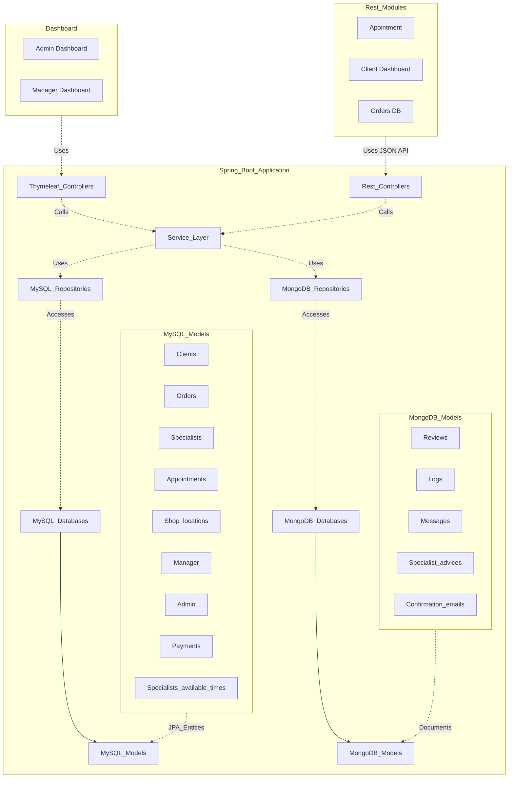

# Architecture summary
This Spring Boot application uses both MVC and REST controllers. 
Thymeleaf templates are used for the Admin and Shop dashboards, while REST APIs serve all other modules. 
The application interacts with two databases—MySQL (for client, specialists, shop, appointment, and admin data) and MongoDB (for reviews). 
All controllers route requests through a common service layer, which in turn delegates to the appropriate repositories. 
MySQL uses JPA entities for structured relational data while MongoDB uses document models for document-based records.

# Numbered flow of data and control
1. **User Interface Interaction:** Users interact with the application via server-rendered Thymeleaf web dashboards (AdminDashboard, SpecialistsDashboard) or REST API clients (Appointments, ClientDashboard, ClientRecord).
2. **Controller Routing:** Incoming HTTP requests are routed based on URL and method to either Thymeleaf Controllers (for web views) or REST Controllers (for API endpoints) to validate input and coordinate the flow.
3. **Business Logic Execution:** Controllers delegate processing to the Service Layer, which enforces business rules, runs validations, and coordinates workflows across entities.
4. **Repository Abstraction:** The service layer calls Spring Data JPA (for relational entities) or Spring Data MongoDB repositories to abstract data persistence and retrieval.
5. **Database Access:** Repositories query the underlying engines directly, accessing MySQL for structured relational data (users, roles, appointments) and MongoDB for flexible document structures (reviews).
6. **Model Binding:** Retrieved database records are mapped into Java objects, converting relational rows into @Entity JPA classes and BSON collections into @Document models.
7. **Response Rendering:** The resulting models (or DTOs) are returned to the controller to either populate dynamic Thymeleaf HTML templates or serialize into JSON HTTP responses for API clients.

